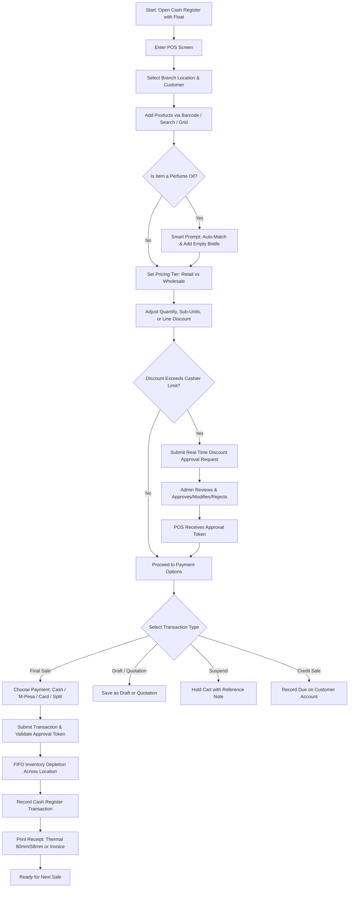
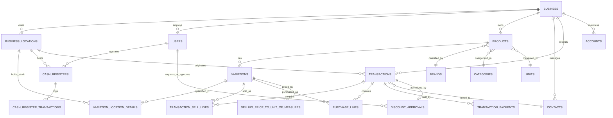

# Vawa Scents POS & Inventory Management System

A multi-location Point of Sale (POS), Inventory Management, and ERP solution built with **Laravel 9** and tailored for fragrance, perfume, and cosmetics retail and wholesale operations. The platform supports retail shops (such as *Vawa Scents Nairobi CBD* and *Juwaka Scents Nairobi*), warehouse distribution hubs, cashier management, multi-tier pricing, fragrance oil-to-bottle automation, real-time discount approvals, Kenyan business localization (KES, M-Pesa, KRA PIN), and comprehensive sales analytics.

---

## Table of Contents

1. [Project Overview](#1-project-overview)
2. [Technology Stack](#2-technology-stack)
3. [Main Features](#3-main-features)
4. [POS Workflow & Operations](#4-pos-workflow--operations)
5. [Inventory & Stock Management](#5-inventory--stock-management)
6. [Payments & Cash Management](#6-payments--cash-management)
7. [Printing & Invoicing](#7-printing--invoicing)
8. [Reporting & Analytics](#8-reporting--analytics)
9. [Database Architecture & Core Entities](#9-database-architecture--core-entities)
10. [Project Directory Structure](#10-project-directory-structure)
11. [Installation & Local Setup](#11-installation--local-setup)
12. [Environment Variables](#12-environment-variables)
13. [System Configuration](#13-system-configuration)
14. [Development & Maintenance Commands](#14-development--maintenance-commands)
15. [Production Deployment Guide](#15-production-deployment-guide)
16. [Security Architecture](#16-security-architecture)
17. [Troubleshooting & Common Issues](#17-troubleshooting--common-issues)
18. [Important Notes & Business Conventions](#18-important-notes--business-conventions)

---

## 1. Project Overview

### What is Vawa Scents POS?
**Vawa Scents POS** is an enterprise-grade retail and wholesale Point of Sale (POS) and inventory control system. Built on top of Laravel, it is customized specifically for perfume houses, fragrance dispensaries, beauty stores, and multi-branch retail enterprises.

### Purpose and Main Business Use Case
Fragrance retail operations deal with unique inventory and sales mechanics:
- Selling pure perfume oils by volume (milliliters) alongside matching empty spray/roller bottles.
- Operating multiple retail outlets (e.g., Vawa Scents Nairobi CBD, Juwaka Scents Nairobi) supplied by central warehouse distribution centers.
- Supporting multi-tier pricing structures (Retail, Wholesale, Unit of Measure pricing).
- Preventing unauthorized cashier discounts via an integrated real-time Manager/Admin Discount Approval workflow.
- Managing localized payments including M-Pesa mobile money, cash denominations, bank transfers, credit sales, and multi-split payments.
- Tracking inventory in real time using FIFO (First-In, First-Out) batch costing, lot tracking, and low-stock alerts.

### Target Audience & Users
- **Store Owners & Directors**: Complete financial visibility, branch comparison, sales analytics, and business configuration.
- **Store / Branch Managers**: Stock reception, discount approval authorization, cash register verification, local inventory audits.
- **Warehouse Officers**: Inter-store dispatches, central stock receipts, batch tracking, and inventory adjustments.
- **Cashiers & Sales Staff**: Fast barcode/touchscreen checkout, customer registration, quotation/draft creation, and receipt printing.
- **Accountants**: Chart of accounts, customer/supplier ledgers, payment tracking, balance sheets, and trial balances.

### Key Capabilities
- **Real-Time Multi-Location Operations**: Multi-store stock segregation, centralized database, and location-based access control.
- **Fragrance Engine**: Automated suggestion and attachment of matching bottle sizes when perfume oils are added to the cart.
- **Real-Time Discount Approval Workflow**: In-app cashier request modal paired with an instant manager review and approval modal.
- **Central Warehouse Module**: Dedicated warehouse dashboard for stock transfers, dispatches, receiving, and adjustments.
- **Flexible Pricing**: Wholesale vs. Retail price groups, and Unit of Measure (UOM) tiered pricing.
- **Cash Denomination Tracking**: Float and closing denomination counting for cash registers.
- **Comprehensive Document Output**: Standard A4 invoices, 80mm/58mm thermal receipts, packing slips, delivery notes, and barcode labels.

---

## 2. Technology Stack

| Layer / Component | Technology / Library | Version / Details |
| :--- | :--- | :--- |
| **Backend Framework** | Laravel Framework | `^9.51` |
| **Language Runtime** | PHP | `^8.0` (PHP 8.0 - 8.2 compatible) |
| **Database** | MySQL / MariaDB | 5.7+ / 8.0+ / MariaDB 10.3+ |
| **Frontend Architecture** | Blade Templates + Vanilla JS + jQuery | AdminLTE UI with Tailwind & Bootstrap integration |
| **DataTables Engine** | Yajra Laravel DataTables | `^9.19` (`yajra/laravel-datatables-oracle`) |
| **Authentication & RBAC** | Laravel Auth + Spatie Permission | `spatie/laravel-permission: ^5.5` |
| **API Token Security** | Laravel Passport | `11.6.1` (OAuth2 Server & API tokens) |
| **PDF Generation** | DomPDF & mPDF | `barryvdh/laravel-dompdf: ^2.0`, `mpdf/mpdf: ^8.1` |
| **Excel & Data Exports** | Maatwebsite Excel | `^3.1.8` |
| **Barcode Generation** | Milon Barcode Generator | `^9.0` (C128, EAN13, Code39, QR Code, etc.) |
| **Activity Logging** | Spatie Activitylog | `^4.4` |
| **Automated Backups** | Spatie Backup | `^8.0` |
| **Charts & Visualizations**| ConsoleTVs Charts / Chart.js | `^6.5` |
| **SMS Notifications** | Aloha Twilio | `^4.0` |
| **Payment Gateways** | PesaPal, Paystack, PayPal, Stripe, Razorpay, MyFatoorah, Flutterwave | `knox/pesapal`, `srmklive/paypal`, `stripe/stripe-php`, etc. |
| **AI Integrations** | OpenAI PHP Laravel Client | `^0.4.1` |
| **Broadcasting / Realtime**| Pusher PHP Server | `^5.0` |

---

## 3. Main Features

### 1. Point of Sale (POS) & Checkout
- **Intuitive Touch & Barcode POS**: Fast SKU lookup, barcode scanner input, and category/brand browser.
- **Customer Selection & Quick Add**: Select existing customer or register new customer on-the-fly without leaving POS.
- **Smart Fragrance Auto-Bottle Prompt**: Automatically identifies perfume oil volume (e.g. 30ml, 50ml, 100ml) and prompts cashier to add the matching empty perfume bottle.
- **Selling Price Groups & UOM Pricing**: Toggle between Default (Retail) and Wholesale pricing per item or transaction.
- **Inline Line-Item Editing**: Edit quantity, unit price (permission-controlled), line discount, and sub-units.
- **Transaction-Level Discounts**: Percentage or fixed amount discounts with validation.
- **Discount Approval Workflow**: Automated lock if discount exceeds threshold; sends request to manager for instant approval/modification.
- **Tax Calculation**: Supports Inclusive and Exclusive tax rates, plus Group Sub-Taxes.
- **Suspended Sales & Drafts**: Suspend multiple carts with custom notes and resume them at any time.
- **Quotations & Proforma Invoices**: Generate formal customer quotations and convert them to live invoices upon order confirmation.
- **Credit Sales & Customer Accounts**: Charge sales to customer credit ledger with configurable credit limits and payment terms.
- **Recent Transactions & Returns**: View recent transactions directly on the POS screen and trigger direct sell returns.
- **Customer Facing Display**: Dual-screen support (`/customer-display`) displaying current cart, totals, and promotional banners.

### 2. Product & Catalog Management
- **Product Types**: Single products, Variable products (with variation templates, e.g. sizes/colors), and Combo/Bundle products.
- **Fragrance Classification**: Categorized by Olfactory families (e.g. *Oud & Woody*, *Floral & Sweet*, *Citrus & Fresh*, *Amber & Spicy*) and Brands (e.g. *Tom Ford*, *Dior*, *Creed*, *Vawa Signature*).
- **Units of Measure (UOM)**: Base units (e.g., Bottles, Pieces, Liters) and Sub-Units with conversion multipliers.
- **Selling Price to UOM Matrix**: Specific minimum, maximum, and default pricing rules per unit of measure.
- **Custom Barcodes & Labels**: Design and print barcode labels with customizable layouts (SKU, price, business name, expiry date).
- **Bulk Product Import & Bulk Edit**: Import products and variations via CSV/Excel spreadsheets.
- **Warranties & Product Expiry**: Configurable warranty periods and expiration tracking for sensitive stock.

### 3. Inventory, Warehouse & Logistics
- **Multi-Location Inventory**: Independent stock quantity tracking (`qty_available`) across retail branches and warehouses.
- **Central Warehouse Module**:
  - Warehouse Dashboard with stock counts, unit summaries, pending dispatches, and in-transit transfers.
  - Warehouse Dispatches: Formal stock transfer workflow from warehouse to retail shops with shipping charges and status tracking (`pending`, `in_transit`, `completed`).
  - Stock Receiving: Shop-side acknowledgment and stock increment upon transfer arrival.
  - Warehouse Adjustments: Specific adjustment flows for warehouse-held items.
- **Stock Adjustments**: Normal (spillage, minor discrepancies) and Abnormal (breakage, theft, expired stock) adjustments with financial impact tracking.
- **Opening Stock Import**: Dedicated CSV template import for bulk opening stock entry per location.
- **Automated Stock Depletion (FIFO)**: Deducts stock according to purchase batches, maintaining accurate cost-of-goods-sold (COGS).
- **Low Stock Alerts**: Configurable alert threshold per product with dashboard notifications.

### 4. Purchases & Supplier Management
- **Supplier Directory**: Supplier profiles, payment terms, contact details, and transaction history.
- **Purchase Orders & Requisitions**: Create requisitions, issue formal purchase orders, and track order fulfillment.
- **Purchase Invoices**: Record received stock, purchase price, lot numbers, manufacturing and expiry dates.
- **Purchase Returns**: Manage full or partial supplier returns with combined credit note generation.
- **Supplier Ledger & Dues**: Track outstanding payables, make bulk payments, and export supplier account statements.

### 5. Cash Register & Shift Management
- **Register Sessions**: Cashiers open register with opening float and close at end-of-shift.
- **Cash Denominations**: Explicit counting and recording of currency notes and coins (e.g., KES 1000, 500, 200, 100, 50, 20).
- **Payment Method Breakdown**: Automated shift reconciliation for Cash, M-Pesa, Card, Cheque, and Bank Transfer.
- **Cash In / Cash Out**: Record midday float additions or miscellaneous petty cash withdrawals from the register.
- **Register Details & Print**: View and print register shift summaries directly from the POS interface.

### 6. Customer Relationship & Credit Management
- **Customer Database**: Customer profiles, mobile numbers, delivery addresses, tax/PIN numbers, and customer group tiers.
- **Customer Groups**: Tiered discounts or assigned selling price groups (e.g., VIP, Wholesale, Retail).
- **Customer Ledger**: Full audit trail of all invoices, payments, credit sales, and outstanding balances with statement generation.
- **Contact Dues & Pay Contact Due**: Centralized modal to collect payments against outstanding customer balances.

### 7. Accounting & Financial Control
- **Chart of Accounts**: Asset, Liability, Equity, Income, and Expense account classifications.
- **Account Transactions**: Bank deposits, fund transfers between accounts, and direct journal entries.
- **Expense Management**: Categorized business expenses with receipt document attachments and refund handling.
- **Financial Statements**: Real-time Balance Sheet, Trial Balance, Cash Flow, and Payment Account Reports.

---

## 4. POS Workflow & Operations



### Fragrance Oil & Bottle Matching Logic
When a cashier adds an item categorized under *Perfume Oils* (e.g., *Oud Royal 50ml*), the system parses the volume from the product/variation name (e.g., `50ml`) and searches for matching stock under the *Bottles* category (e.g., *50ml Glass Spray Bottle*). A prompt enables instant addition to the cart, ensuring perfume oil and bottle inventory stay perfectly synchronized.

### Discount Approval Lifecycle
1. **Cashier Request**: Cashier enters an override discount on the POS cart and clicks **Request Approval**.
2. **Snapshot Creation**: The system saves a `discount_approvals` record containing the full JSON cart snapshot, requested discount type, amount, original total, resulting total, and cashier notes. Status is set to `pending` with a 30-minute expiry.
3. **Admin Review**: Administrators receive an instant dashboard/header notification. Opening the review modal reveals the full cart contents, customer details, and price impact. The admin can approve, modify discount amounts, or reject with comments.
4. **Token Generation**: Upon approval, a secure, unique 64-character `approval_token` is generated.
5. **POS Checkout**: The POS screen receives the approval token via polling, updates the cart discount, and sends the `approval_token` during final sale submission. The server verifies and marks the token as `used`.

---

## 5. Inventory & Stock Management

### Stock Tracking & Accounting Method
- **FIFO Engine**: Inventory is depleted based on the oldest available purchase lots first (`transaction_sell_lines_purchase_lines`).
- **Location Isolation**: Stock is tracked per variation per location (`variation_location_details`). Stock in *Vawa Scents Nairobi CBD* is completely independent from *Juwaka Scents Nairobi* or *Central Warehouse*.
- **Units & Sub-Units**: Supports primary units (e.g., Box) and secondary sub-units (e.g., Bottles with multiplier 12).
- **Stock Transfers & Dispatches**:
  1. **Transfer Creation**: Origin location (e.g., Warehouse) initiates a `sell_transfer` with status `pending` or `in_transit`. Stock is reserved/deducted from origin.
  2. **Transfer Reception**: Destination location receives the stock, marks status `final`, and destination `variation_location_details` is incremented.
- **Stock Adjustments**:
  - `normal`: Routine operational adjustments (counted in normal loss reports).
  - `abnormal`: Loss due to theft, major breakage, fire, or expired goods (logged separately in financial P&L).

---

## 6. Payments & Cash Management

### Supported Payment Methods
| Method | Code / Key | Description & Behavior |
| :--- | :--- | :--- |
| **Cash** | `cash` | Standard cash payment with change calculator and cash denomination logging. |
| **M-Pesa / Custom Pay**| `custom_pay_1` / `custom_pay_2` | Mobile money transaction tracking with M-Pesa reference code validation. |
| **Card** | `card` | Credit/Debit card with transaction number, card type (Visa/Mastercard), security code. |
| **Cheque** | `cheque` | Cheque number and bank routing reference. |
| **Bank Transfer** | `bank_transfer` | Direct bank account deposit / EFT reference. |
| **Online Gateways** | `pesapal`, `paystack`, `paypal`, `stripe`, `razorpay`, `myfatoorah`, `flutterwave` | Integrated online payment gateways for invoice links and proforma payments. |
| **Credit Sale (Due)** | `due` | Balance recorded against customer account; increments customer outstanding ledger. |
| **Multiple / Split** | *Multi-row* | Combine multiple methods on a single sale (e.g., KES 2,000 Cash + KES 3,500 M-Pesa). |

### Cash Register Reconciliation
- **Opening Register**: Cashier enters opening float balance.
- **Shift Activity**: Every cash, card, and M-Pesa transaction automatically links to the open register session (`cash_register_transactions`).
- **Closing Register**: Cashier enters physical cash counts broken down by denomination, enters total card/M-Pesa slips, adds closing notes, and prints the shift audit report.

---

## 7. Printing & Invoicing

### Supported Document Formats
1. **POS Receipts (Thermal 80mm & 58mm)**:
   - Layout styles: `slim`, `slim2`, `classic`, `elegant`, `detailed`, `columnize-taxes`.
   - Includes: Business logo, branch address, KRA PIN, cashier name, invoice number, itemized lines, discounts, tax breakdown, payment method & references, change returned, barcode, and footer message.
2. **Standard Invoices (A4 / Letter)**: For corporate clients, wholesale orders, and proforma invoices.
3. **Packing Slips**: Product line breakdown without pricing, formatted for warehouse picking and dispatch.
4. **Delivery Notes**: Formal dispatch documents for transport drivers and customer delivery sign-off.
5. **Barcode & Price Labels**: Configurable label sheet layouts (20-up, 30-up, continuous roll, jewelry/bottle tags).

### Printer Connection Types
Printers can be configured under **Settings → Receipt Printers**:
- **Browser Print (Default)**: Leverages the browser's native print dialog for thermal and standard printers.
- **Network / Ethernet / Wi-Fi Printer**: Direct ESC/POS printing via IP address and Port (e.g., `192.168.1.100:9100`).
- **Windows Shared Printer**: Direct ESC/POS via Windows printer sharing path (e.g., `LPT1` or `\\localhost\POS80`).
- **Linux Local Device**: Direct ESC/POS printing via device path (e.g., `/dev/usb/lp0`).

---

## 8. Reporting & Analytics

| Report Name | Route | Key Metrics & Information Shown | Available Filters |
| :--- | :--- | :--- | :--- |
| **Comprehensive Sales Analytics** | `/reports/sales-analytics` | Total revenue, average order value, item count, net tax, net discount, daily/weekly/monthly grouped trends, visual charts, period transaction inspection, and Excel/PDF export. | Date Range, Location, Customer, Cashier, Group By (Daily/Weekly/Monthly/Yearly) |
| **Profit / Loss Report** | `/reports/profit-loss` | Gross Profit, Net Profit, Total COGS, Total Sales, Operating Expenses, Stock Adjustments, Shipping Charges, and Profit by Location/Product/Category. | Date Range, Location |
| **Purchase & Sale Report**| `/reports/purchase-sell` | Total purchases vs total sales, purchase dues, sales dues, purchase returns, and sales returns summary. | Date Range, Location |
| **Stock Report** | `/reports/stock-report` | Current stock on hand, stock value by purchase price, stock value by sale price, potential profit, and unit quantities. | Location, Category, Sub-Category, Brand, Unit |
| **Stock Expiry & Lots** | `/reports/stock-expiry` | Lot numbers, manufacturing dates, expiration dates, stock remaining per batch, and expired stock alerts. | Location, Expiry Window, Category, Brand |
| **Trending Products** | `/reports/trending-products` | Top-selling items by quantity and gross sales volume with interactive visual charts. | Date Range, Location, Category, Brand, Limit |
| **Discount Approvals Report**| `/reports/discount-approvals` | Complete log of all cashier discount requests, original vs resulting totals, approving admin, approval status, timestamps, and cashier/admin notes. | Status (`pending`, `approved`, `modified`, `rejected`, `used`, `expired`), Location, Date Range |
| **Register Report** | `/reports/register-report` | Cash register shift logs, opening floats, total cash/M-Pesa/card received, cash in/out, and discrepancies. | User, Location, Status (Open/Closed), Date Range |
| **Tax Report** | `/reports/tax-report` | Output tax (sales), Input tax (purchases), tax liability, and detailed tax rate breakdown. | Date Range, Location |
| **Customer / Supplier Report** | `/reports/customer-supplier` | Customer & supplier balances, total purchase/sale transactions, total paid, and total due. | Contact Type, Customer Group, Location |
| **Activity Log** | `/reports/activity-log` | Audit trail of user logins, created/modified transactions, discount approvals, price changes, and system events. | User, Date Range, Subject Type |
| **Financial Accounting Reports** | `/account/balance-sheet`, `/account/trial-balance`, `/account/cash-flow` | Balance sheet assets & liabilities, debit/credit trial balance, payment account reconciliations, and cash flow statement. | Location, Financial Year, Date Range |

---

## 9. Database Architecture & Core Entities



### Key Database Tables

1. **`business`**: Multi-tenant business master table containing name, currency ID, time zone (`Africa/Nairobi`), tax labels (`PIN`), accounting method (`fifo`), and serialized settings.
2. **`business_locations`**: Stores and warehouse branches with address details, invoice scheme IDs, invoice layout IDs, printer assignments, and `location_type` (`shop` vs `warehouse`).
3. **`users`**: System users, cashier credentials, role assignments, custom commission percentages, and allowed business locations.
4. **`products`**: Master catalog storing name, type (`single`, `variable`, `combo`), SKU, brand ID, category ID, unit ID, alert quantities, and tax configurations.
5. **`variations`**: Specific variant records storing sub-SKU, default purchase price, profit markup percentage, and default selling price.
6. **`variation_location_details`**: Real-time stock levels (`qty_available`) per variation per location.
7. **`selling_price_to_unit_of_measures`**: Tiered and UOM pricing rules (e.g. 30ml, 50ml, 100ml pricing per variation).
8. **`transactions`**: Central document ledger storing sales (`sell`), purchases (`purchase`), transfers (`sell_transfer`), returns (`sell_return`, `purchase_return`), adjustments (`stock_adjustment`), expenses (`expense`), and quotations. Contains transaction dates, invoice/ref numbers, total amounts, discount amounts, tax amounts, and payment statuses (`paid`, `due`, `partial`).
9. **`transaction_sell_lines`**: Itemized lines for sales transactions containing variation ID, quantity, unit price before/after discount, line tax, and sub-unit multiplier.
10. **`purchase_lines`**: Inventory intake lines storing purchase price, quantity purchased, quantity sold, lot numbers, and expiry dates.
11. **`transaction_sell_lines_purchase_lines`**: FIFO link table connecting sold items directly to the specific purchase batches depleted.
12. **`transaction_payments`**: Individual payment records storing method (`cash`, `card`, `custom_pay_1`, `bank_transfer`), amount, payment date, reference numbers, and linked financial account ID.
13. **`discount_approvals`**: Real-time discount request audit table storing cashier ID, approving admin ID, status, requested/approved discount amounts, cart snapshot JSON, and unique one-time `approval_token`.
14. **`cash_registers` & `cash_register_transactions`**: Cashier shift sessions, opening/closing amounts, and detailed transactional cash movements.
15. **`contacts` & `customer_groups`**: Customers and suppliers with contact numbers, tax numbers, credit limits, opening balances, and assigned price tiers.
16. **`accounts` & `account_transactions`**: Chart of accounts, account types, journal ledger debit/credit postings, and fund transfers.

---

## 10. Project Directory Structure

```
vawa-scents-pos/
├── app/
│   ├── Console/Commands/       # Artisan CLI maintenance & scheduled commands
│   ├── Events/ & Listeners/    # System event handlers (e.g., StockTransfer events)
│   ├── Exports/                # Excel/CSV export classes (e.g., SalesReportExport)
│   ├── Http/
│   │   ├── Controllers/        # Core controllers (SellPos, Product, Report, etc.)
│   │   │   ├── Auth/           # Authentication controllers (Login, Password, etc.)
│   │   │   ├── Install/        # Web installer controllers
│   │   │   ├── Restaurant/     # Table, kitchen & booking controllers
│   │   │   └── Warehouse/      # Warehouse Dashboard, Dispatch, Stock & Adjustments
│   │   ├── Middleware/         # Auth, Session, Timezone, AdminSidebarMenu, Warehouse
│   │   └── helpers.php         # Global formatting & business helper functions
│   ├── Models/
│   │   ├── Custom/             # SellingPriceToUnitOfMeasure model
│   │   └── StockTaking/        # Stock taking & physical audit models
│   ├── Services/
│   │   └── Warehouse/          # Warehouse Dispatch, Location, Stock & Adjustment services
│   ├── Utils/                  # Heavyweight domain business logic & transaction engines
│   │   ├── BusinessUtil.php    # Business creation, defaults & settings
│   │   ├── CashRegisterUtil.php# Register opening, closing & denomination logic
│   │   ├── ContactUtil.php     # Customer/supplier ledgers & balances
│   │   ├── ProductUtil.php     # Products, variations, barcodes, pricing & stock
│   │   ├── TransactionUtil.php # Sales, purchases, payments, FIFO depletion, invoices
│   │   └── Util.php            # Number & date unformatting, sanitization, currency formatting
│   ├── DiscountApproval.php    # Discount approval model
│   ├── Transaction.php         # Master transaction model
│   ├── Product.php             # Product model
│   └── User.php                # User & Staff model
├── config/                     # Application, database, auth, payment, and constant configs
├── database/
│   ├── factories/              # Model factories for testing
│   ├── migrations/             # Full database schema history (300+ migrations)
│   └── seeders/                # Database seeders (VawaScentsSeeder, Permissions, Barcodes, Currencies)
├── public/
│   ├── css/                    # Compiled CSS, Tailwind, AdminLTE, vendor styles
│   ├── js/                     # Application JS (pos.js, common.js, functions.js)
│   ├── uploads/                # Uploaded product images, documents, and business logos
│   └── index.php               # Laravel HTTP entry point
├── resources/
│   ├── views/                  # Blade templates
│   │   ├── layouts/            # Master layout wrappers & partials (sidebar, header, css, js)
│   │   ├── sale_pos/           # POS terminal views, receipt designs, payment modals
│   │   ├── product/            # Product catalog, variation, label printing views
│   │   ├── warehouse/          # Warehouse dashboard, dispatch, and receiving views
│   │   └── report/             # Sales analytics, profit/loss, and inventory reports
│   └── lang/                   # Localization dictionaries (en, es, fr, ar, etc.)
├── routes/
│   ├── web.php                 # Core application web routes & authenticated resource endpoints
│   ├── api.php                 # API endpoints & Passport authenticated routes
│   └── install_r.php           # Setup wizard routes
├── storage/                    # Application logs, generated PDFs, and session data
├── composer.json               # PHP package dependencies & autoload definitions
└── .env.example                # Template for environment configuration
```

---

## 11. Installation & Local Setup

### System Prerequisites
Ensure your local development machine or server meets the following requirements:
- **PHP**: Version `8.0`, `8.1`, or `8.2`
- **Required PHP Extensions**: `bcmath`, `ctype`, `curl`, `dom`, `fileinfo`, `gd` (or `imagick`), `json`, `mbstring`, `openssl`, `pcre`, `pdo`, `pdo_mysql`, `tokenizer`, `xml`, `zip`.
- **MySQL / MariaDB**: MySQL 5.7+ / 8.0+ or MariaDB 10.3+
- **Composer**: Composer 2.x
- **Web Server (optional for local)**: Apache 2.4+ / Nginx 1.18+

### Step-by-Step Setup Instructions

#### 1. Clone the Repository
```bash
git clone <repository_url> vawa-scents-pos
cd vawa-scents-pos
```

#### 2. Install PHP Dependencies
```bash
composer install --optimize-autoloader --no-interaction
```

#### 3. Configure Environment File
```bash
cp .env.example .env
```
Generate the application key:
```bash
php artisan key:generate
```

#### 4. Configure Database Credentials
Edit the `.env` file and configure your database connection parameters:
```env
DB_CONNECTION=mysql
DB_HOST=127.0.0.1
DB_PORT=3306
DB_DATABASE=vawa_scents_pos
DB_USERNAME=your_db_user
DB_PASSWORD=your_db_password
```
*(Ensure the database `vawa_scents_pos` exists in your MySQL server before running migrations)*.

#### 5. Run Database Migrations & Base Seeders
Run database migrations to build all system tables:
```bash
php artisan migrate
```
Run the base lookup seeders (Barcodes, Permissions, Currencies):
```bash
php artisan db:seed
```

#### 6. Seed Vawa Scents Business & Demo Data (Recommended)
To automatically set up the **Vawa Scents** business profile, Kenyan localization (KES Currency, Nairobi Timezone, KRA PIN), default stores (*Vawa Scents Nairobi CBD* & *Juwaka Scents Nairobi*), perfume products, categories, suppliers, stock, and default users, execute:
```bash
php artisan db:seed --class="Database\Seeders\VawaScentsSeeder"
```

**Default Seeded Credentials:**
| Role | Username | Email | Password | Assigned Scope |
| :--- | :--- | :--- | :--- | :--- |
| **Main Admin** | `vawa_admin` | `admin@vawascents.com` | `password` | Global Admin Access |
| **Co-Admin** | `vawa_admin_2` | `coadmin@vawascents.com`| `password` | Global Admin Access |
| **Nairobi CBD Cashier** | `cashier_nairobi` | `nairobi_cashier@vawascents.com` | `password` | Nairobi CBD Branch |
| **Juwaka Scents Cashier** | `cashier_mombasa` | `mombasa_cashier@vawascents.com` | `password` | Juwaka Scents Nairobi Branch |
| **Float Cashier** | `cashier_seasonal`| `seasonal_cashier@vawascents.com`| `password` | Float / Seasonal |

#### 7. Create Storage Symlink & Passport Keys
```bash
php artisan storage:link
php artisan passport:keys --force
```

#### 8. Start the Local Development Server
```bash
php artisan serve
```
Access the application at `http://127.0.0.1:8000` in your web browser.

---

## 12. Environment Variables

Below are the key configuration variables defined in `.env.example`:

| Variable | Default / Example | Purpose |
| :--- | :--- | :--- |
| `APP_NAME` | `"Vawa Scents POS"` | Application brand name displayed in headers and emails. |
| `APP_ENV` | `local` / `production` | Environment mode (`local` for development, `production` for live). |
| `APP_KEY` | `base64:...` | 32-character encryption key for sessions and credentials. |
| `APP_DEBUG` | `true` / `false` | Displays verbose debugging stack traces (Must be `false` in production). |
| `APP_URL` | `http://localhost` | Canonical base URL used for asset loading, emails, and webhooks. |
| `APP_LOCALE` | `en` | Default application UI language. |
| `APP_TIMEZONE` | `"Africa/Nairobi"` | Default server timezone. |
| `LOG_CHANNEL` | `daily` | Laravel logging strategy (`daily`, `single`, `stack`). |
| `DB_CONNECTION` | `mysql` | Database driver name. |
| `DB_HOST` | `127.0.0.1` | Database server hostname or IP address. |
| `DB_PORT` | `3306` | Database listening port. |
| `DB_DATABASE` | `vawa_scents_pos` | Target database schema name. |
| `DB_USERNAME` | `homestead` | Database username. |
| `DB_PASSWORD` | `secret` | Database password. |
| `BROADCAST_DRIVER` | `pusher` / `log` | Event broadcasting driver for real-time notifications. |
| `CACHE_DRIVER` | `file` / `redis` | Application caching backend. |
| `SESSION_DRIVER` | `file` / `redis` | Session storage engine. |
| `QUEUE_CONNECTION`| `sync` / `database` | Background job processing queue driver. |
| `MAIL_MAILER` | `smtp` | Mail sending driver. |
| `MAIL_HOST` | `smtp.mailtrap.io` | SMTP server host. |
| `MAIL_PORT` | `2525` / `587` | SMTP port. |
| `MAIL_USERNAME` | `null` | SMTP authentication user. |
| `MAIL_PASSWORD` | `null` | SMTP authentication password. |
| `MAIL_FROM_ADDRESS`| `info@vawascents.com` | Default sender email address. |
| `MAIL_FROM_NAME` | `"Vawa Scents"` | Default sender display name. |
| `PUSHER_APP_ID` | `""` | Pusher application ID for real-time alerts. |
| `PUSHER_APP_KEY` | `""` | Pusher public application key. |
| `PUSHER_APP_SECRET`| `""` | Pusher private secret key. |
| `PUSHER_APP_CLUSTER`| `"mt1"` | Pusher region cluster. |
| `BACKUP_DISK` | `"local"` / `"s3"` / `"dropbox"` | Destination storage disk for automated database backups. |
| `PESAPAL_CONSUMER_KEY` | `""` | PesaPal API consumer key for Kenyan payments. |
| `PESAPAL_CONSUMER_SECRET` | `""` | PesaPal API consumer secret. |
| `PESAPAL_CURRENCY` | `KES` | PesaPal processing currency. |
| `PESAPAL_LIVE` | `false` | Enable live production PesaPal endpoints. |

---

## 13. System Configuration

- **Application Settings**: Configured in `config/app.php` and `config/constants.php`.
- **Date & Time Formats**: Controlled per business in **Settings → Business Settings** (Default date format: `m/d/Y` or `d/m/Y`, 12h/24h time).
- **Currency & Precision**: Set to **KES (Kenyan Shilling)** with standard 2 decimal places for currency and 2 for quantity precision.
- **Invoice Schemes & Layouts**: Configured via **Settings → Invoice Settings**. Invoice numbering prefixes can be customized per branch (e.g. `INV-NBO-` for Nairobi CBD, `INV-JWK-` for Juwaka Scents).
- **Business Locations & Warehouse Setup**: Managed via **Settings → Business Locations**. Locations can be flagged as `shop` or `warehouse`.

---

## 14. Development & Maintenance Commands

### Local Server & Asset Management
```bash
# Start Laravel development server
php artisan serve

# Run interactive Tinker REPL
php artisan tinker
```

### Cache & Optimization Management
```bash
# Clear all cached layers
php artisan config:clear
php artisan cache:clear
php artisan route:clear
php artisan view:clear

# Optimize for production (compile config, routes & views)
php artisan config:cache
php artisan route:cache
php artisan view:cache
```

### Database Operations
```bash
# Run pending migrations
php artisan migrate

# Check migration status
php artisan migrate:status

# Rollback last migration batch
php artisan migrate:rollback

# Reset database completely and re-seed Vawa Scents data
php artisan migrate:fresh --seed
php artisan db:seed --class="Database\Seeders\VawaScentsSeeder"
```

### Backup & Log Management
```bash
# Run an immediate backup of database and files
php artisan backup:run

# Run database-only backup
php artisan backup:run --only-db

# Clean older backup archives
php artisan backup:clean
```

### Running Automated Tests
```bash
# Run PHPUnit test suite
./vendor/bin/phpunit
```

---

## 15. Production Deployment Guide

### Recommended Server Stack
- **Operating System**: Ubuntu 22.04 LTS or 24.04 LTS
- **Web Server**: Nginx (reverse proxy with FastCGI)
- **PHP**: PHP 8.1 / 8.2-FPM
- **Database**: MySQL 8.0 Server
- **Process Manager**: Supervisor (for queue workers)

### 1. Document Root Configuration
Ensure your web server's virtual host root points directly to the `public/` subdirectory, **not** the project root.

#### Example Nginx Virtual Host Configuration:
```nginx
server {
    listen 80;
    listen [::]:80;
    server_name pos.vawascents.com;
    root /var/www/vawa-scents-pos/public;

    add_header X-Frame-Options "SAMEORIGIN";
    add_header X-Content-Type-Options "nosniff";

    index index.php index.html;
    charset utf-8;

    location / {
        try_files $uri $uri/ /index.php?$query_string;
    }

    location = /favicon.ico { access_log off; log_not_found off; }
    location = /robots.txt  { access_log off; log_not_found off; }

    error_page 404 /index.php;

    location ~ \.php$ {
        fastcgi_pass unix:/var/run/php/php8.1-fpm.sock;
        fastcgi_param SCRIPT_FILENAME $realpath_root$fastcgi_script_name;
        include fastcgi_params;
        fastcgi_hide_header X-Powered-By;
    }

    location ~ /\.(?!well-known).* {
        deny all;
    }
}
```

### 2. File & Directory Permissions
Set correct file ownership to the web server user (`www-data`):
```bash
sudo chown -R www-data:www-data /var/www/vawa-scents-pos
sudo find /var/www/vawa-scents-pos -type f -exec chmod 644 {} \;
sudo find /var/www/vawa-scents-pos -type d -exec chmod 755 {} \;

# Grant writable permissions to storage and bootstrap cache
sudo chmod -R 775 /var/www/vawa-scents-pos/storage
sudo chmod -R 775 /var/www/vawa-scents-pos/bootstrap/cache
```

### 3. Production Deployment Checklist
1. `APP_ENV=production` and `APP_DEBUG=false` in `.env`.
2. Run database migrations: `php artisan migrate --force`.
3. Create storage symlink: `php artisan storage:link`.
4. Cache configuration and routes:
   ```bash
   php artisan config:cache
   php artisan route:cache
   php artisan view:cache
   ```
5. Configure Cron job for scheduled tasks:
   ```bash
   crontab -e -u www-data
   ```
   Add:
   ```cron
   * * * * * cd /var/www/vawa-scents-pos && php artisan schedule:run >> /dev/null 2>&1
   ```

---

## 16. Security Architecture

- **Session Security & Encryption**: User sessions are guarded via secure, HTTP-only, encrypted cookie tokens.
- **CSRF Protection**: All POST/PUT/DELETE requests are validated through the `VerifyCsrfToken` middleware. POS AJAX endpoints automatically include the `X-CSRF-TOKEN` header.
- **Granular Role-Based Access Control (RBAC)**: Permissions are managed via `spatie/laravel-permission`. Roles are scoped to businesses (e.g. `Admin#1`, `Cashier#1`). User accounts can be strictly restricted to specific store locations (`location.<id>`).
- **Discount Approval Security**: Prevents cashiers from giving arbitrary discounts. Requests require admin authorization and produce a single-use token (`approval_token`) that is verified server-side on sale finalization.
- **SQL Injection Prevention**: Eloquent ORM and PDO parameter binding are used across all database queries.
- **Activity Logging & Audit Trail**: Critical events (discount requests, price modifications, user updates, stock adjustments) are logged to the `activity_log` table with user attribution and timestamping.
- **Password Security**: Passwords are saved using standard `bcrypt` hashing with configurable minimum complexity requirements.

---

## 17. Troubleshooting & Common Issues

### 1. HTTP 500 / Permission Denied on `storage/` or `bootstrap/cache`
**Symptom**: Blank screen or error log stating `The stream or file ".../laravel.log" could not be opened in append mode: failed to open stream: Permission denied`.  
**Solution**:
```bash
sudo chown -R www-data:www-data storage bootstrap/cache
sudo chmod -R 775 storage bootstrap/cache
```

### 2. Images, Barcodes, or Uploads Not Displaying (404 Not Found)
**Symptom**: Product thumbnails or receipt logos are broken.  
**Solution**: Ensure the public storage symlink exists:
```bash
php artisan storage:link
```

### 3. Changes to `.env` Are Not Taking Effect
**Symptom**: Database or payment credentials updated in `.env` are ignored.  
**Solution**: Clear cached configuration:
```bash
php artisan config:clear
php artisan cache:clear
```

### 4. Direct Thermal Printing Fails / No Response from Printer
**Symptom**: Print command sends but nothing outputs on ESC/POS thermal printer.  
**Solution**:
- If using **Network Printer**: Verify IP address and port (default: 9100) are reachable from the web server using `ping` or `telnet <ip> 9100`.
- If using **Browser Print**: Ensure printer driver is set to 80mm/58mm roll with zero margins in the browser print dialog.

### 5. Cashier Discount Approval Request Timeout
**Symptom**: POS displays *Request Expired* when waiting for admin discount response.  
**Solution**: Approval requests automatically expire after 30 minutes. Ensure the store manager has an active dashboard session to review pending requests under **Discount Approvals**.

---

## 18. Important Notes & Business Conventions

1. **Kenyan Currency & Localization**:
   - Currency: **Kenyan Shilling (KES)** (Currency ID: 133).
   - Timezone: `Africa/Nairobi` (EAT / UTC+3).
   - Tax Identification: Configured with label **PIN** (KRA PIN) for tax compliance.
2. **Multi-Branch Hierarchy**:
   - Branch 1: **Vawa Scents Nairobi CBD** (Main Shop).
   - Branch 2: **Juwaka Scents Nairobi** (Branch Shop).
   - Central Warehouse: Configured with `location_type = 'warehouse'` for staging and bulk distribution.
3. **Perfume Oil to Bottle Auto-Linking**:
   - Perfume oil products are categorized under olfactory groups (*Oud & Woody*, *Floral & Sweet*, *Citrus & Fresh*, *Amber & Spicy*).
   - When a fragrance oil is added to the cart, the system inspects volume (`ml`) and pairs it with matching empty bottles from the *Bottles* category.
4. **Cashier Permissions**:
   - Cashiers are assigned to specific store locations and have POS screen access, cash register management, and quotation creation permissions.
   - Cashiers cannot edit product purchase costs, delete finalized sales, or approve their own discount requests.
